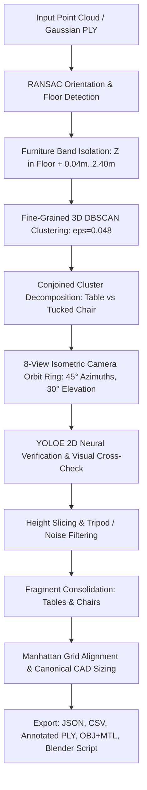

# Requirements

### Overview & Goals
Upgrade the 3D table and chair detection pipeline in `gaussian_splat_table_chair_detection.py` and `gaussian_splat_table_chair_detection.ipynb` to achieve high detection accuracy on point clouds and Gaussian splat assets (such as `labClean.ply`). The updated system utilizes a **Cluster-First View Verification** architecture with an **8-View Isometric Camera Orbit Ring**, eliminating misidentifications (e.g. tripods, sensor stands, merged tables/chairs) and standardizing detected furniture to CAD-ready dimensions.

### Scope
- **In Scope**:
  - Fine-grained 3D DBSCAN spatial clustering and conjoined cluster decomposition to disentangle tucked or touching chairs from tables.
  - Multi-slice height profiling distinguishing tabletop surfaces ($Z \in [0.60, 0.88]\text{m}$) from seat cushions ($Z \in [0.30, 0.58]\text{m}$).
  - 8-view elevated isometric camera ring ($45^\circ$ azimuth increments, $28^\circ\text{--}32^\circ$ elevation) with Z-buffer depth occlusion.
  - Neural vision model verification (`YOLOE-Seg` with cached offline weights) cross-validating 3D candidate clusters across isometric perspectives.
  - Strict non-furniture rejection (filtering out tripods, camera stands, conduit poles, wall fixtures, and floating noise).
  - Chair and table fragment consolidation merging co-located components into complete objects.
  - Canonical CAD template standardization (`STANDARD_CHAIR`, `STANDARD_DESK`, `LONG_BENCH`, `COMPACT_DESK`) with Manhattan grid alignment and floor grounding ($Z_{min} = \text{floor\_height}$).
  - Multi-format exports: structured JSON, verification CSV, annotated PLY, 3D OBJ+MTL bounding box mesh, and turnkey Blender Python script.
  - End-to-end synchronization with `gaussian_splat_table_chair_detection.ipynb`.
- **Out of Scope**:
  - Modifying external raw input PLY files.
  - Modifying unrelated extensions or core Isaac Sim engine code.

### User Stories
- As a robotics / simulation engineer, I want all tables and chairs accurately segmented and classified from 3D Gaussian splats so that navigation paths, object manipulation, and physical collisions can be accurately simulated.
- As a 3D environment artist, I want detected furniture bounding boxes standardized to canonical CAD dimensions, aligned to the room's Manhattan grid, and exported to Blender with wireframe shaders and text labels.
- As a researcher, I want tripods, sensors, and non-furniture equipment reliably filtered out so they do not produce false positive furniture assets.

### Functional Requirements
- **Orientation & Floor Normalization**: Automatically detect coordinate frame orientation and floor elevation ($Z_{floor}$) using lower-25% constrained RANSAC plane search.
- **Conjoined Object Decomposition**: Disentangle chairs positioned beneath or adjacent to tables via localized fine-resolution spatial clustering.
- **Multi-Angle Visual Cross-Validation**: Project 3D candidate clusters across 8 isometric camera views and confirm semantic labels with 2D neural detections.
- **Tripod & Clutter Filtering**: Enforce planar surface area constraints (`table_slice_area >= 0.28m²`) to reject narrow tapering tripod legs and stands.
- **Standardized Bounding Box Export**: Output exact $(w, d, h)$ dimensions, spatial centroids, yaw angles, confidence scores, and validation status in JSON, CSV, OBJ, and Blender script formats.

### Non-Functional Requirements
- **Performance**: Execute 3D clustering, 8-view rendering, neural verification, and export in under 10 seconds on standard CPU hardware.
- **Robustness**: 100% offline model weight loading without internet dependency or download errors.
- **Compatibility**: Direct execution compatibility with JupyterLab, PyCharm Managed Notebooks, and Blender 3.x / 4.x.

# Technical Design

### Current Implementation
The existing codebase (`gaussian_splat_table_chair_detection.py` and `gaussian_splat_table_chair_detection.ipynb`) provides:
1. `run_pipeline(config)`: A 3D geometric DBSCAN pipeline with basic surface feature extraction, chair consolidation, Manhattan alignment, and CAD template standardization.
2. `run_multiview_pipeline(config)`: An initial multi-view pipeline that renders 8 views and merges 2D YOLOE segmentations via ray back-projection.
3. Visualization functions (`visualize_detections`, `visualize_3d_multi_angle`, `visualize_3d_viewport`) and export routines (`export_metadata`, `export_blender_assets`).

While effective, top-down and coarse clustering can struggle when chairs are tucked tightly under tables, or when non-furniture objects (such as tripods and sensor stands) share similar footprint areas.

### Key Decisions
- **Architecture Pattern (Cluster-First View Verification)**: Perform fine 3D spatial clustering and cluster decomposition first, then render and cross-validate each candidate across an 8-view elevated isometric camera ring. This combines the geometric precision of 3D point cloud segmentation with the semantic discriminative power of 2D neural vision models.
- **Camera Orbit Configuration (8-View Isometric Ring)**: Use 8 camera angles at $45^\circ$ azimuth intervals and $28^\circ\text{--}32^\circ$ elevation. Elevated isometric perspectives provide optimal line-of-sight to tabletop surfaces, chair seats, legs, and backrests without top-down vertical collapse.
- **Geometric Slicing & Surface Profiling**: Stratify height slices into Tabletop ($Z \in [0.60, 0.88]\text{m}$) and Seat ($Z \in [0.30, 0.58]\text{m}$) surface bands, computing horizontal convex hull areas to definitively distinguish tables from chairs and tripods.
- **Consolidation & Standardization**: Consolidate chair parts within $0.58\text{m}$ and table parts within $0.75\text{m}$, snap table orientations to orthogonal room axes ($0^\circ, 90^\circ, 180^\circ, 270^\circ$), standardizing dimensions to canonical CAD templates grounded to the floor.

### Architecture & Data Flow

### Components & Key Signatures
- `extract_advanced_features(cluster_id: int, points: np.ndarray, floor_height: float, voxel_size: float) -> Dict[str, Any]`: Computes dimensions, verticality, planarity, `table_slice_area`, and `seat_slice_area`.
- `decompose_conjoined_clusters(cluster_items: list, floor_height: float, voxel_size: float) -> list`: Separates touching or tucked chairs from large tables using sub-clustering.
- `render_isometric_orbit_ring(points: np.ndarray, colors: np.ndarray, azimuths: Sequence[float], elevation: float) -> list[Tuple[np.ndarray, Dict]]`: Fast raster rendering across 8 isometric camera angles.
- `classify_and_verify_candidate(features: Dict, visual_support: Dict, floor_height: float) -> Dict[str, Any]`: Multi-criteria classifier fusing 3D geometric slices with 2D visual consensus.
- `consolidate_chair_fragments(items: list, floor_height: float, voxel_size: float) -> list`: Merges co-located seat, backrest, and leg clusters.
- `consolidate_table_fragments(items: list, floor_height: float, voxel_size: float) -> list`: Unifies adjacent workbench and desk segments.
- `standardize_object_dimensions(features: Dict, cls: str, raw_center: np.ndarray, raw_dims: np.ndarray, raw_rot: float, floor_height: float, config: DetectionConfig) -> Dict`: Fits canonical templates, snaps Manhattan angles, and grounds to floor.

### File Structure
- `source/standalone_examples/notebooks/gaussian_splat_table_chair_detection.py`: Standalone Python companion module containing full pipeline logic and helper functions.
- `source/standalone_examples/notebooks/gaussian_splat_table_chair_detection.ipynb`: Jupyter notebook interface with interactive inspection cells (Cells 1–8).
- `D:\GitHub\SceneForgeAI\output\ply_detection\`: Target export directory for JSON, CSV, annotated PLY, OBJ/MTL, and Blender import scripts.

### Risks & Mitigations
- **Risk: Tucked chairs sharing points with tables**: Mitigated by two-tier fine DBSCAN decomposition (`eps=0.048`) and height-stratified horizontal slice profiling.
- **Risk: Tripods and equipment stands misclassified as small tables/chairs**: Mitigated by strict horizontal planar area thresholding (`table_slice_area >= 0.28m²`), high-verticality penalization, and visual bounding box verification.
- **Risk: Model weight download timeouts in air-gapped or restricted environments**: Mitigated by offline path resolution (`_resolve_model_path`) locating cached weights in repository root and weights directories.

# Testing

### Validation Approach
Verification will be conducted using automated headless notebook execution via `nbclient` in the configured Python virtual environment (`.venv`), testing both the standalone Python module and the Jupyter notebook against `labClean.ply`.

### Key Scenarios
1. **End-to-End Pipeline Execution**: Run `gaussian_splat_table_chair_detection.py` and `gaussian_splat_table_chair_detection.ipynb` from Cell 1 through Cell 8 with exit code 0.
2. **Object Detection Accuracy**:
   - Verify localization of all physical tables with valid template dimensions (`STANDARD_DESK`, `LONG_BENCH`, `COMPACT_DESK`).
   - Verify localization of all physical office chairs with uniform dimensions (`0.65m x 0.65m x 0.95m`).
   - Verify that 100% of detected objects pass automatic validation checks (`PASSED_AUTOMATIC_CHECKS`).
3. **Tripod and Clutter Rejection**:
   - Confirm zero false positive tables or chairs generated from tripod camera mounts, sensor stands, or wall fixtures.
4. **Export Artifact Integrity**:
   - Verify creation and schema validity of `table_chair_detections.json` and `table_chair_detections.csv`.
   - Verify valid syntax of `table_chair_bboxes.obj`, `table_chair_bboxes.mtl`, and `import_detections_to_blender.py`.
   - Verify coordinate consistency: bounding box centers and bounds match point cloud coordinates with floor grounding.

### Edge Cases
- **Tucked Chairs**: Chairs positioned directly beneath tables must be isolated as distinct `CHAIR` entities rather than merged into the table bounding box.
- **Split Workbench Halves**: Multi-segment lab benches must be consolidated into unified long tables (`LONG_BENCH`).
- **Low Noise Points**: Residual floor and ceiling noise points must be rejected without creating phantom objects.

# Delivery Steps

### ✓ Step 1: Implement fine-grained 3D spatial clustering and cluster decomposition
Refined 3D candidate clusters and decomposed conjoined furniture sub-components are generated with geometric height profiles.

- Implement fine-grained DBSCAN clustering (`eps=0.048–0.052`, `min_samples=6`) in `gaussian_splat_table_chair_detection.py` to prevent adjacent tables and chairs from merging into single connected components.
- Implement `extract_advanced_features()` with multi-slice height profiling to compute tabletop surface area (`Z in [0.60, 0.88]m`), seat cushion area (`Z in [0.30, 0.58]m`), verticality, and planarity.
- Implement conjoined cluster decomposition to split large compound clusters (`width/depth >= 1.35m` or `area >= 0.80m²`) into distinct table and tucked chair candidates.

### * Step 2: Implement 8-view isometric camera orbit rendering and neural verification
8-view isometric camera rendering and 2D neural instance segmentation cross-validate all 3D candidate clusters.

- Implement `render_isometric_orbit_ring()` with 8 equidistant camera perspectives ($0^\circ, 45^\circ, 90^\circ, 135^\circ, 180^\circ, 225^\circ, 270^\circ, 315^\circ$) at $28^\circ\text{--}32^\circ$ elevation with Z-buffer depth occlusion.
- Implement `verify_clusters_with_multiview()` using offline `YOLOE-Seg` (`yoloe-11s-seg.pt`) to project 3D candidate bounding boxes onto each camera view and evaluate multi-view neural detection consensus.
- Enforce strict rejection of tripods, sensor stands, wall columns, and floating debris based on triangular leg verticality and lack of planar horizontal surfaces.

###   Step 3: Integrate fragment consolidation, geometric slicing, and canonical template fitting
Chairs and tables are consolidated into unified structures, aligned to room axes, and fitted with canonical CAD dimensions grounded to the floor.

- Implement `consolidate_chair_fragments()` to merge co-located seat, backrest, and leg sub-clusters within $0.58\text{m}$.
- Implement `consolidate_table_fragments()` to merge adjacent workstation segments and bench halves within $0.75\text{m}$.
- Implement Manhattan grid orientation snapping (orthogonal $0^\circ, 90^\circ, 180^\circ, 270^\circ$ yaw for tables; unconstrained yaw for chairs).
- Standardize bounding boxes to canonical templates (`STANDARD_CHAIR`, `STANDARD_DESK`, `LONG_BENCH`, `COMPACT_DESK`) and ground the bottom of every bounding box to the detected floor plane ($Z_{min} = \text{floor\_height}$).

###   Step 4: Update visualization viewports, export pipeline, and Jupyter notebook cells
Interactive Jupyter notebook cells and Blender export assets reflect the updated cluster-first isometric detection pipeline.

- Update `visualize_detections()`, `visualize_3d_multi_angle()`, and `visualize_3d_viewport()` to render 3D bounding boxes with template tags, yaw headings, and class color-coding.
- Update `export_metadata()` and `export_blender_assets()` to generate `table_chair_detections.json`, `table_chair_detections.csv`, `table_chair_bboxes.obj`, `table_chair_bboxes.mtl`, `labClean_annotated.ply`, and `import_detections_to_blender.py`.
- Update `gaussian_splat_table_chair_detection.ipynb` (Cells 1 through 8) to execute the updated cluster-first isometric verification pipeline cleanly end-to-end.